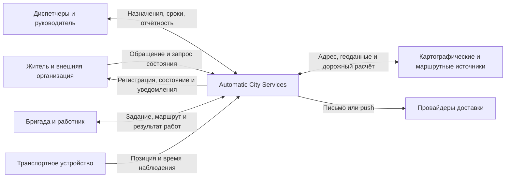
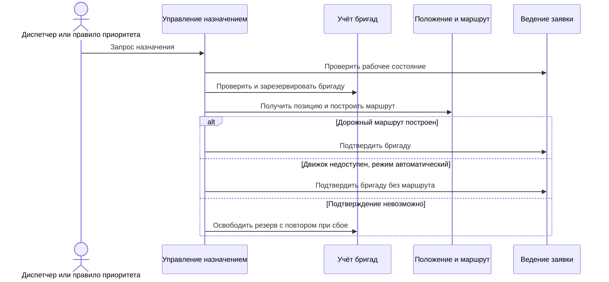
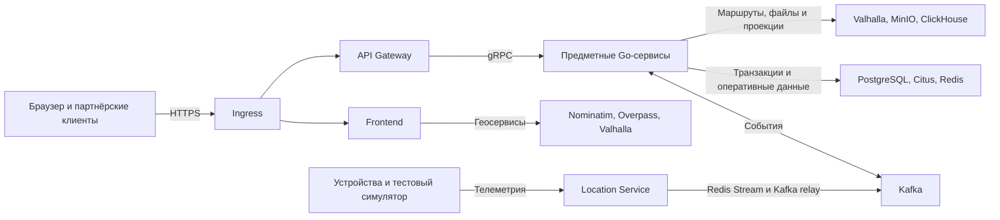

# Анализ Automatic City Services по методу ARCADIA

Срез проекта от 23 ноября 2026 года, ветка `test`, коммит `a74467ca570da9bc02e217fd123422caa334cffb`.

Automatic City Services связывает сообщения о городских проблемах с работой департаментов и бригад. Главная архитектурная задача — сохранить ответственность, состояние работы и наблюдаемый результат при переходе между обращением, общим инцидентом, назначением и полевыми работами. Наиболее существенные вопросы по текущей реализации касаются свежести координат при подтверждении назначения, влияния архивации на составной инцидент и порядка работы бригады при назначении без маршрута.

## Применение ARCADIA

| Перспектива | Объём и причина |
| --- | --- |
| Операционный анализ (OA) | Основной цикл городской службы, участники, передача ответственности и исключения. Без этого уровня трудно установить, кого должно устраивать закрытие общей проблемы. |
| Анализ системной потребности (SA) | Граница системы, внешние взаимодействия и наблюдаемые требования. Нужен для проверки обещаний жителю, диспетчеру и работнику. |
| Логическая архитектура (LA) | Функциональные цепочки, владельцы состояния и взаимодействия при отказе. Нужна из-за независимых жизненных циклов заявок, резервов, маршрутов и документов. |
| Физическая архитектура (PA) | Развёртываемые сервисы, связи, узлы исполнения и зависимости критического пути. Достаточно уровня компонентов и сред, поскольку аппаратная конфигурация площадки и профиль нагрузки требуют данных конкретного внедрения. |
| Интеграция, верификация и валидация (IVV) | Сквозная матрица от операционной цели до критерия и свидетельства. В ARCADIA IVV — часть инженерной работы и подготовки контрактов компонентов. Пятая перспектива относится к стратегии построения и структуре конечного продукта (EPBS). Для этого среза достаточно распределения компонентов и проверок на их стыках. Полная EPBS приобретает смысл при отдельных поставках, закупках или приёмке подсистем разными сторонами. |

OA и SA реконструированы по сценариям и ограничениям проекта. Утверждение операционных правил остаётся за владельцами процесса. LA и PA фиксируют фактическую архитектуру среза. Каждое существенное предложение по изменению вынесено в выводы или критерии валидации. [Описание метода ARCADIA](https://mbse-capella.org/arcadia.html) · [Разъяснения Capella о перспективах и IVV](https://mbse-capella.org/arcadia-qna.html)

## 1. Операционный анализ

### Назначение и предметная область

Миссия городской службы в границах анализа — принять сигнал о проблеме, определить ответственных, организовать работы и сообщить о результате. Место, время, категория и ведомство позволяют сопоставлять сигналы, но для подтверждения совпадения важен сам дефект. Например, рядом могут одновременно находиться повреждённый фонарь и другой фонарь с отказавшим питанием. Обращение, городской инцидент и объект инфраструктуры поэтому имеют разные идентификаторы и смысл. Обращение сохраняет связь с конкретным заявителем, инцидент объединяет работы вокруг проблемы, а объект позволяет видеть историю нескольких проблем и ремонтов. Сведения о заявителе, положении бригады, сроках и документе о работах нужны участникам для разных решений.

Близкий отраслевой ориентир для внешнего канала — Open311 GeoReport v2. Он описывает приём и отслеживание геопривязанных городских обращений. Внутренний процесс проекта охватывает также распределение работ между подразделениями, бригады, маршрутизацию и доказательства выполнения. Вопросы регламента ведомства, охвата экстренных случаев и обязательных сроков зависят от конкретного внедрения. Приоритет `EMERGENCY` здесь имеет смысл внутри системы диспетчеризации. [Обзор проекта](../../README.md) · [Жизненный цикл заявки](../../wiki/Ticket-Lifecycle.md) · [Open311 GeoReport v2](https://wiki.open311.org/GeoReport_v2/)

| Участник | Операционные действия и получаемый результат |
| --- | --- |
| Житель | Сообщает, где и что произошло, получает подтверждение, отслеживает своё обращение и после завершения оценивает результат. |
| Внешняя организация | Передаёт обращение от своего источника с собственным идентификатором. Нужна однозначная связь между повторной отправкой и ранее принятым обращением. |
| Диспетчер подразделения | Определяет приоритет и исполнителя, учитывает территорию, доступность и квалификацию бригады. При межведомственном случае координирует свою часть и наблюдает общий прогресс. |
| Бригада и работник | Принимают задание, добираются до места, выполняют работы, меняют состояние и фиксируют результат. Сам выезд и ремонт происходят в операционной среде. |
| Смежное подразделение | Отвечает за свои работы и передаёт их результат для оценки состояния общего инцидента. |
| Администратор или руководитель службы | Поддерживает справочники, структуру и интеграции. Использует сроки, отчёты, аудит и аналитику для контроля. |

### Возможности и операционные сценарии

| Возможность | Нормальный сценарий | Отклонение, требующее решения |
| --- | --- | --- |
| OA-01. Принять и классифицировать сигнал | Житель или партнёр сообщает адрес, категорию и обстоятельства. Служба регистрирует обращение и связывает его с подходящим инцидентом либо открывает новый. | Повтор доставки, похожая соседняя неисправность, неверная категория или ответственное ведомство. |
| OA-02. Организовать выезд | Диспетчер или правило приоритета подбирает бригаду. Бригада получает задание и сведения о месте работ. | Нет пригодной бригады, потерян сигнал, недоступен маршрут или после резерва сорвалось подтверждение. |
| OA-03. Координировать несколько подразделений | Диспетчеры распределяют части. Каждое ведомство подтверждает свой результат. Общий результат определяется по всем связанным частям. | Одна часть отменена, ошибочно присоединена, ожидает другое ведомство или слишком долго остаётся открытой. |
| OA-04. Завершить работы и дать обратную связь | Работник фиксирует выполнение и материалы. Житель узнаёт об изменении состояния и может подтвердить или оспорить практический результат через оценку. | Работы завершены, а документ, уведомление или сторонний канал ещё недоступны. |
| OA-05. Управлять сроками, активами и качеством | Дежурный видит приближение нарушений сроков. Руководитель анализирует работу и историю активов. | Данные запаздывают, источник метрики неполон, а запись о выполнении нуждается в проверке. |

Пример OA-03. При подтоплении одна служба восстанавливает водоотведение, другая устраняет последствия на дороге. Первая может закончить свой участок раньше, тогда её диспетчер видит выполненную часть при ещё открытом общем инциденте. Если вторая служба не может выполнить работы, нужен явный исход с ответственной стороной и причиной, который видит координатор.

## 2. Анализ системной потребности

### Граница и обмены

В систему входят пользовательские интерфейсы, приём и хранение обращений, управление назначениями и состояниями, обработка телеметрии, учёт сроков, уведомления, документы, реестр объектов, аудит и аналитика. За границей находятся люди и ведомства, системы-поставщики обращений, транспортные устройства, картографические и коммуникационные провайдеры. Полевое выполнение и решение об организационной эскалации принадлежат участникам. Расчёт маршрута считается внешней зависимостью прикладного контура даже там, где движок развёрнут в том же кластере.

### Наблюдаемые требования для проверки

| Идентификатор | Операционная цель | Ожидаемая реакция системы |
| --- | --- | --- |
| SA-01 | OA-01 | Принять обращение и вернуть идентификатор. Повтор `external_id` для той же интеграции и департамента должен возвращать ранее принятое обращение. Совпадение по месту, категории и времени связывает обращения с инцидентом, сохраняя их отдельные записи. |
| SA-02 | OA-02 | Проверить назначаемость заявки и пригодность бригады. Успешное назначение должно дать наблюдаемую согласованность карточки, операции и бригады. Сбой после резервирования должен оставлять возможность завершить освобождение резерва. |
| SA-03 | OA-02 | Представлять доступность координат и маршрута отдельно. Диспетчер и бригада должны различать маршрут с ETA, отсутствие маршрута и устаревшие координаты, когда это меняет решение о выезде. |
| SA-04 | OA-03 | Показывать прогресс частей и ответственность ведомств. Завершение всех учитываемых частей переводит инцидент в завершённое состояние. Отмена части, отсоединение и архивирование требуют явной политики. |
| SA-05 | OA-04 | Разрешать работнику менять состояние задачи своей бригады и фиксировать материалы. Отдельно показывать результат работы, формирование итогового документа и доставку сообщения. |
| SA-06 | OA-05 | Рассчитывать сроки реакции и выполнения по применимому правилу. Просрочка и смена состояния должны быть доступны диспетчеру независимо от способа доставки уведомлений. |
| SA-07 | OA-01–05 | Ограничивать чтение и изменения ролью и предметной принадлежностью: автором, подразделением или бригадой. Прослеживать значимые действия и связывать их с идентификаторами предметных записей. |
| SA-08 | OA-01–05 | После временного сбоя восстанавливать критичные операции и события без лишних предметных изменений. Отдельно измерять доступность, возраст событий и восстановление данных. |
| SA-09 | OA-05 | Связывать историю объекта с обращениями и ремонтами, а показатели руководителя — с источниками и временем обновления. |

SA-03 и SA-04 включают требования к приемлемому поведению, которые выходят за рамки простого описания реализации. Их критерии нуждаются в согласовании с диспетчерами и владельцем процесса. Технические цели уже заданы для шлюза и инфраструктуры. Целевые значения для времени «обращение принято → заявитель видит изменение», восстановления конкретных предметных потоков и производственных RPO/RTO требуют согласования на целевом контуре. [OpenAPI Gateway](../../API_Gateway/src/core/handlers/openapi.json) · [Правила SLA](../../SLA_Service/README.md) · [Технические SLO](../../k8s/base/observability/SLO.md)

## 3. Логическая архитектура

### Ответственность за состояние и распределение функций

| Компонент LA | Ответственность и состояние | Реализация PA |
| --- | --- | --- |
| LA-01. Приём и ведение обращений | Обращение, инцидент, категория, связи частей, история переходов, оценка и запись отчёта о работе. | Frontend, API Gateway, Ticket Service. |
| LA-02. Управление назначением | Операция от запроса и резерва до подтверждения, ошибки или истечения. Решение читает состояние заявки и бригады у владельцев. | Dispatch Service, клиенты Ticket, Brigade, Location и Routing. |
| LA-03. Ресурсы службы | Подразделение, рабочий профиль, бригада, состав, навыки, доступность и смена. | Department, Profile, Brigade. |
| LA-04. Положение и маршрут | Последняя позиция и состояние сигнала, геоистория, расчёт поездки и состояние сохранённого маршрута. | Location и Routing. |
| LA-05. Результат работ | Регистрация отчёта, создание документа, хранение метаданных файлов и двоичных данных. | Ticket хранит WorkReport, Report формирует документ, File ведёт состояние файлов. |
| LA-06. Сроки и связь с участниками | Регламент и история SLA, пользовательские уведомления и попытки доставки. | SLA, Notification. |
| LA-07. Идентичность, доступ и подотчётность | Учётная запись, контекст роли и принадлежности, журнал значимых изменений. | Auth, Profile, Gateway и предметные проверки, Audit. |
| LA-08. Объекты и показатели | Паспорт и история объекта, аналитические представления событий и сводные метрики. | Asset, Analytics, Report для выгрузок. |

### Критические функциональные цепочки

- **Приём и объединение, SA-01.** Ticket хранит идентичность каждого `REQUEST`. Поиск ближайшего активного `INCIDENT` ограничен той же категорией и департаментом, окном 24 часа и радиусом 100 м. Повтор входящей отправки партнёра обрабатывается отдельным правилом по `external_id`. Изменение состояния и публикация через outbox дают потребителям независимые основания для пересчёта SLA и уведомления. [Параметры сопоставления](../../Ticket_Service/models/request.go) · [Транзакция приёма и поиск](../../Ticket_Service/src/core/repository/request_repo.go)
- **Назначение, SA-02 и SA-03.** Dispatch подтверждает, что заявка `NEW`, проверяет пригодность бригады, резервирует её, читает позицию, строит маршрут и подтверждает назначение в Ticket. Поиск кандидатов в автоматическом режиме исключает устаревшие позиции и использует ETA при наличии дорожного расчёта. При ошибке доступности Routing ранжирование может использовать расстояние по прямой с неизвестной ETA. При такой ошибке во время подтверждения и действующем контексте автоматический режим может назначить бригаду без сохранённого маршрута. Ручное подтверждение в этой ситуации завершается ошибкой и освобождает резерв. Отдельный потребитель запускает автоназначение на `ticket.created` с приоритетом `EMERGENCY` при настроенной Kafka. [Workflow Dispatch](../../Dispatch_Service/src/core/service/workflow.go) · [Резервный расчёт](../../Dispatch_Service/src/core/service/routing_fallback.go) · [Потребитель событий Ticket](../../Dispatch_Service/src/infrastructure/ticketconsumer/worker.go)
- **Междепартаментное выполнение, SA-04.** У каждой части собственные статус, исполнитель, история и отчёт. Диспетчер управляет связью части своего департамента. Ticket закрывает инцидент в транзакции, когда выполняется условие по неархивным частям. Отмена части без изменения связи блокирует закрытие, пока часть учитывается. [Связи и закрытие инцидента](../../Ticket_Service/src/core/repository/request_repo.go) · [Сценарий междепартаментной работы](../../Ticket_Service/src/integration/ticket_grpc_integration_test.go)
- **Подтверждение результата, SA-05 и SA-06.** Задача проходит `NEW → ASSIGNED → IN_PROGRESS → DONE`. Из трёх рабочих состояний предусмотрена отмена. Формирование документа асинхронно: Ticket записывает WorkReport и запрос, Report создаёт артефакт через File, Ticket применяет результат. SLA и Notification независимо обрабатывают предметные события. Прикладной статус работы, результат генерации файла и результат доставки сообщения имеют свои источники состояния. [Переходы и итоговый отчёт](../../Ticket_Service/README.md) · [Формирование артефакта](../../Report_Service/src/infrastructure/completionconsumer/worker.go) · [Применение результата](../../Ticket_Service/src/infrastructure/reportconsumer/worker.go)
- **Согласованность после отказа, SA-08.** При отмене или ошибке после резерва Dispatch хранит `release_pending` и повторяет освобождение после перезапуска. В цепочках с transactional outbox публикация может повториться, если подтверждение брокера получено до обновления записи издателя. Потребители должны дедуплицировать эффект в пределах своего контракта. Публикация Location использует Redis Stream, а отдельные результаты Report публикуются самим worker. [Восстановление Dispatch](../../Dispatch_Service/src/core/service/service.go) · [Карта издателей и потребителей](code-interactions.md)

### Состояния, которые важно различать

Согласованность назначения задаётся тройкой «заявка — операция — бригада». Маршрут связывается с назначением при наличии, а для инцидента согласованность рассчитывается по его частям. Например, `CONFIRMING` относится к операции, `ASSIGNED` — к заявке или завершившейся операции назначения, `BUSY` — к бригаде, а `PENDING` у WorkReport означает незавершённую подготовку документа. Экран, который сводит эти состояния в один индикатор, скрывает необходимое диспетчеру решение. [Состояния Dispatch](../../Dispatch_Service/README.md) · [Состояния Ticket](../../Ticket_Service/README.md)

### Свойства архитектурных решений

| Решение | Что даёт | Что требуется для сохранения свойства |
| --- | --- | --- |
| Операция назначения координирует несколько владельцев состояния | Диспетчер получает предметный результат вызова, а Ticket, Brigade и Routing сохраняют собственные правила. | Резерв, подтверждение и компенсация должны восстанавливаться из сохранённой операции. Особый случай — Ticket принял команду, а ответ потерян. Повторная проверка назначения должна завершить исходную операцию. [Подтверждение Dispatch](../../Dispatch_Service/src/core/service/workflow.go) |
| Последующие эффекты передаются событиями | Приём обращения продолжает работать при сбое отдельного потребителя уведомлений или аналитики. | Дедупликация применения, наблюдаемое отставание и процедура обработки DLQ нужны для каждой важной проекции. Видимый статус заявки и состояние производных операций могут расходиться во времени. [Событийные взаимодействия](code-interactions.md) |
| Обращения связаны через общий инцидент при сохранении ведомственного владения | Департамент управляет своей работой, а общий прогресс можно вывести из частей. | Правила изменения связи, терминальных состояний и хранения должны давать стабильный и объяснимый результат. При размещении частей на разных шардах требуется проверить конкурирующие завершения на целевой топологии. [Транзакции Ticket](../../Ticket_Service/src/core/repository/request_repo.go) · [Топология Citus](../../k8s/docs/postgres-ha.md) |

## 4. Физическая архитектура

На схеме показан контур с ingress. Отдельные маршруты браузера к тайлам и объектному хранилищу, а также способы доставки уведомлений перечислены в таблице и карте взаимодействий.

| Узел или зависимость | Размещение и интерфейсы | Что зависит от узла |
| --- | --- | --- |
| Клиент и вход | Браузер и сервер Frontend, HTTP и WebSocket в API Gateway. В контурах с mesh внешний трафик проходит через Istio ingress, а шлюз обращается по gRPC к 15 Go-сервисам. | Регистрация, оформление заявки и рабочие места. Серверные маршруты карт обращаются к Nominatim, Overpass и Valhalla. Тайлы и загрузка по подписанным ссылкам имеют отдельные сетевые пути. |
| Операционные приложения | Kubernetes Deployments и Services. Helm задаёт образы, переменные, пробы, миграции и параметры реплик. | Ticket, Dispatch, Brigade, Location и Routing образуют критический путь назначения. Auth и данные профиля определяют доступность рабочих действий. |
| Транзакционные данные | PostgreSQL и PostGIS. В HA-контуре — платформенный Patroni с отдельными БД и учётными данными сервисов, отдельная топология Ticket Citus по `department_id`, доступ через PgBouncer. | Запись заявок и истории, резервы, права, SLA и outbox. Для чтения после записи имеет значение выбор primary вместо реплики. Междепартаментный инцидент пересекает ключ распределения. |
| События и оперативные данные | Kafka для обмена и фоновой обработки. Redis используется для текущих координат, Redis Stream телеметрии, живых уведомлений и ограничений шлюза. У Location есть Sentinel-конфигурация. | Задержка потребителей влияет на SLA, уведомления, отчёты, аудит и аналитику даже при успешном ответе шлюза. |
| Маршруты, файлы и аналитика | Valhalla, MinIO/S3 и ClickHouse. SMTP и FCM зависят от настроек и доступности провайдера. Симулятор координат выступает отдельным источником тестовой телеметрии. | Дорожная маршрутизация, доступ к вложениям и отчётам, аналитические представления. Готовность Valhalla требует рабочих данных дорожного графа и успешного запроса маршрута. |
| Наблюдаемость и поставка | Prometheus, Grafana, OpenTelemetry, Jaeger, Elasticsearch, Filebeat, Kibana и Kiali. Kustomize описывает инфраструктуру. GitHub Actions, Flux и Flagger участвуют в выпуске по правилам контура. | Сбор метрик, расследование задержек, канареечный выпуск и восстановление. Helm-откат приложения оставляет мигрированную схему, поэтому между релизами нужна совместимость. |

Уровень физических компонентов описан в [карте взаимодействий](code-interactions.md), [описании Kubernetes](../../k8s/README.md), [порядке развёртывания](../../k8s/docs/deployment.md) и [топологии PostgreSQL HA](../../k8s/docs/postgres-ha.md).

- **Контуры.** `local` предназначен для функциональной разработки. `local-ha` подходит для проверки связей Patroni, Citus и Istio. `dev` проверяет выпуск в отдельном namespace. `prod` требует реальных тегов образов, параметров хранилища, секретов и проверок конкретного кластера. Docker Compose служит отдельным способом локального запуска. [Контуры и ограничения выпуска](../../k8s/docs/deployment.md)
- **Границы отказа.** Платформенный PostgreSQL объединяет несколько БД в общий домен отказа. Шардинг Ticket требует отдельной проверки междепартаментных транзакций на Citus. Базовые StatefulSet для ClickHouse и Valhalla содержат по одной реплике, поэтому сохранение аналитики и маршрутизации при их отказе зависит от конкретного развёртывания и правил деградации. Реплики PostgreSQL помогают с доступностью. Восстановимость данных зависит от архива WAL, резервной копии и проверенного восстановления. [Топология БД и PITR](../../k8s/docs/postgres-ha.md) · [ClickHouse StatefulSet](../../k8s/base/data/clickhouse/statefulset.yaml) · [Valhalla StatefulSet](../../k8s/base/data/valhalla/statefulset.yaml)
- **Измеримость.** Заданы целевые 99,9% доступности Gateway и 99% запросов Gateway быстрее 1 с на семидневном окне. Kafka lag ниже 100 сообщений используется как приближение свежести. Для сроков, видимых пользователю, требуется измерять возраст от записи события до доступности результата. Нагрузочные сценарии задают методику и критерии, а фактическую пропускную способность определяет испытание выбранной конфигурации. [Технические SLO](../../k8s/base/observability/SLO.md) · [Нагрузочные сценарии](../../load-tests/README.md)

## 5. Верификация и валидация

### Свидетельства этого среза

- Выполнены локальные Go-тесты сервисного уровня Ticket, Dispatch, Routing и SLA. Среди прошедших проверок — права работника на задачи своей бригады, ранжирование по ETA, обработка отсутствующих свежих позиций при подборе, резервное ранжирование при недоступном Routing и обработка событий SLA. Дополнительный прогон охватил сервисный уровень Location, Notification, Report, File, Analytics, Audit и Asset, а также часть потребителей и фоновых обработчиков. Тесты обработчиков Gateway прошли, включая закрытие WebSocket при отключении клиента. Для этой проверки понадобилось разрешённое локальное TCP-соединение. Интеграционные проверки File с внешней тестовой БД пропущены.
- Прошли два статических теста Playwright. Они сверили инвентарь OpenAPI из 203 HTTP-операций, включая 192 с JWT и 11 публичных, с описанными сценариями. HTTP-вызовы к фактическому Gateway здесь не проверялись. [Inventory Playwright](../../Frontend/playwright.inventory.config.ts) · [Классы свидетельств API](../../API_Gateway/e2e/COVERAGE.md)
- Успешно собраны представления Kustomize для `local/infra`, `local-ha/support`, `local-ha`, `dev` и `prod`. Это проверка сборки манифестов. Для проверки запуска, маршрутов и политик нужен Kubernetes.
- Ticket integration на временной PostgreSQL пропущен из-за недоступного Docker Engine. Проверки восстановления Dispatch и границы доступа к PostgreSQL пропущены из-за отсутствия тестовых DSN. В частности, оба вложенных сценария `TestAutomaticDispatchWithoutRouting` были пропущены, хотя родительский тест напечатал `PASS`. Кластерный API E2E пропущен. Активный Kubernetes context отсутствовал.

### Матрица трассировки и критерии приёмки

| Цепочка | Проверяемый результат | Текущее свидетельство | Что завершает проверку |
| --- | --- | --- | --- |
| OA-01 → SA-01 → LA-01 | Каждый заявитель сохраняет своё обращение. Повтор партнёра возвращает тот же ID, а повтор с новой заявкой может привязаться к общему инциденту. | Ветви кода, интеграционный и E2E-сценарии. Интеграционный прогон пропущен. [Создание и повторы](../../Ticket_Service/src/core/repository/request_repo.go) · [Тесты Ticket API](../../Frontend/e2e/gateway-tickets-stateful.spec.ts) | Прогнать на PostgreSQL и Citus с одновременной отправкой, граничными 100 м и 24 ч, двумя близкими, но различными объектами и повтором `external_id`. Сверить число строк и связи. |
| OA-02 → SA-02 → LA-02, LA-03 | При конкуренции одно назначение получает заявку и резерв. После отмены или отказа резерв можно освободить после рестарта. | Код блокировок и сохранённой компенсации. Сценарии восстановления PostgreSQL пропущены. [Тесты компенсации](../../Dispatch_Service/src/core/service/recovery_integration_test.go) | Запустить два резерва и отказ после записи состояния. После рестарта сверить Ticket, Dispatch, Brigade, Routing и outbox по идентификаторам. |
| OA-02 → SA-03 → LA-02, LA-04 | Потеря сигнала обнаруживается в момент подтверждения. Когда допустимо автоматическое назначение без маршрута, участники видят этот режим и получают пригодные указания о месте работ. | Unit-тесты подбора и ранжирования прошли. Подтверждение без маршрута и компенсация на PostgreSQL пропущены. [Тесты подбора](../../Dispatch_Service/src/core/service/routing_fallback_test.go) · [Тесты подтверждения](../../Dispatch_Service/src/core/service/routing_recovery_test.go) | Дать бригаде потерять свежий сигнал между подбором и подтверждением. Отдельно отключить Routing при свежей позиции. Сверить исход назначения, ETA, индикатор режима и восстановление доступа к маршруту в рабочих интерфейсах. |
| OA-03 → SA-04 → LA-01 | Ведомства выполняют части независимо. Последняя учитываемая выполненная часть закрывает инцидент один раз. Отмена и архивирование дают согласованный исход. | Правила в коде и существующие тесты на обычном PostgreSQL и через Gateway. Текущий прогон пропущен. [Междепартаментные тесты](../../Ticket_Service/src/integration/ticket_grpc_integration_test.go) · [Обработчик архивации](../../Ticket_Service/src/infrastructure/retentionworker/worker.go) | На Citus параллельно завершить части из разных департаментов. Отдельно отменить и архивировать одну часть, затем сравнить прогресс, допустимость закрытия, историю и событие `ticket.completed` с согласованным правилом. |
| OA-04 → SA-05 → LA-05, LA-06 | Работа завершается, документ либо доступен по валидной ссылке, либо находится в явном состоянии ошибки или ожидания. Уведомление не подменяет результат работы. | Сага и тестовый сценарий полного цикла в исходниках. Полный прогон с Kafka и S3 не выполнен. [Ход работы и отчёт](../../Frontend/e2e/gateway-tickets-stateful.spec.ts) · [Отчёты и артефакты](../../Frontend/e2e/gateway-reports-stateful.spec.ts) | Повторить событие о документе, прервать File или Report на промежуточном этапе, восстановить обработку. Проверить единый результат, вложение и чтение жителем и работником по своим правам. |
| OA-05 → SA-06 → LA-06 | Сроки применяют правило нужного департамента, категории и приоритета, а просрочка сохраняется после восстановления доставки событий. | Модульный тест Consume прошёл, есть тесты правил и отдельный API-сценарий. [Сервисные тесты SLA](../../SLA_Service/src/core/service/service_test.go) · [Сценарии SLA Gateway](../../Frontend/e2e/gateway-sla-stateful.spec.ts) | Проверить переходы SLA и историю на контролируемом времени, затем повтор и задержку события. Измерить время появления просрочки в интерфейсе. |
| OA-01–05 → SA-07 → LA-07 | Сотрудник видит и меняет только разрешённые сущности. Межведомственный просмотр состава следует утверждённому правилу. | Unit-тесты Ticket и Dispatch, статический инвентарь JWT. Проверки ограничения Dispatch на уровне PostgreSQL пропущены. [Права Ticket](../../Ticket_Service/src/core/service/ticket_service_test.go) · [Граница Dispatch](../../Dispatch_Service/src/core/service/access_integration_test.go) | На изолированном стенде проверить матрицу ролей для чтения, изменения и аудита. Для отрицательных случаев сверить отсутствие предметной записи или события. |
| OA-01–05 → SA-08 → PA | После отказа и повторной доставки сохранились заявки, резервы и важные события, а обработка укладывается в целевые сроки. | Outbox, retry и DLQ в коде отдельных потоков, сборка манифестов, сценарий изолированного PITR в CI. Измерений целевого контура за этот срез нет. [CI интеграции и восстановления](../../.github/workflows/ci.yml) · [Ограничения лабораторного PITR](../../k8s/docs/postgres-ha.md) | На стенде проверить переключение Patroni, восстановление Citus и догон Kafka. Измерить RPO, RTO, возраст событий и сверить число предметных операций до и после сбоя. |
| OA-05 → SA-09 → LA-08 | История объекта и итоговые показатели сходятся с исходными событиями, включая изменения состояния и повтор доставки. | Код и тесты API присутствуют. Сценарий чтения с PostgreSQL и ClickHouse не выполнялся на стенде. [Сценарии объектов](../../Frontend/e2e/gateway-assets-stateful.spec.ts) · [Аналитика](../../Analytics_Service/README.md) | Создать ограниченный набор обращений, выездов и событий обслуживания. Сверить число сущностей, доли, даты, область данных и отставание проекции. |

Верификация отвечает, воспроизводит ли реализация согласованное правило. Для валидации нужны представители службы. Диспетчеры двух ведомств должны пройти OA-03 с отменённой частью и договориться, кто закрывает или перенаправляет работу. Диспетчер и бригада должны пройти OA-02 с пропавшей позицией и с отсутствующим маршрутом и определить допустимое решение о выезде. Житель и работник должны пройти OA-04 с задержкой документа и проверить, что состояние понятно и доступно для действий. Критерий — участники могут определить, кто отвечает за следующий шаг, какое решение доступно сейчас и что считается завершением.

## Архитектурные выводы

| Приоритет анализа | Наблюдение и последствие | Решение или требуемая проверка |
| --- | --- | --- |
| Высокий | **Свежесть позиции теряется между подбором и подтверждением.** Preview запрашивает пакет с `AllowStale: false`. Confirm читает одиночную позицию и проверяет её наличие, хотя Location возвращает `SignalStatus`. При сохранённой устаревшей позиции дорожный маршрут может начаться с устаревшей точки. Ручное назначение также использует одиночное чтение. | Согласовать политику свежести для обоих режимов и проверить потерю сигнала после резерва. [Подбор и подтверждение](../../Dispatch_Service/src/core/service/workflow.go) · [Одиночное и пакетное чтение позиции](../../Location_Service/src/core/repository/current_location_repo.go) |
| Высокий | **Архивирование может изменить условие завершения общего инцидента.** Подсчёт и список частей исключают `ARCHIVED`. Retention worker включён по умолчанию и переводит терминальные `DONE` и `CANCELED` в `ARCHIVED` после заданного срока, по умолчанию 24 часа. Отменённая часть перестаёт препятствовать следующей проверке закрытия, а архивирование выполненной части может менять видимый прогресс. Сама архивация записывает историю и событие, без пересчёта родительского инцидента в этой операции. | Зафиксировать, является ли архивирование допустимым основанием для изменения состава и нужен ли неизменный итог по каждой части. Проверить связку закрытия, архивации и повторного чтения на Citus. [Подсчёт и список частей](../../Ticket_Service/src/core/repository/request_repo.go) · [Настройки архивации](../../Ticket_Service/src/cmd/server/retention.go) · [Retention worker](../../Ticket_Service/src/infrastructure/retentionworker/worker.go) |
| Высокий | **`ASSIGNED` может означать назначение без маршрута.** Dispatch фиксирует `dispatch.routing_degraded`, а `route_id` может остаться пустым. Прямое расстояние не даёт дорожного времени прибытия. Общая схема назначения в документации показывает только путь с маршрутом. | Утвердить видимое состояние и действия смены при деградации, включая порядок получения маршрута после восстановления. Сверить экран диспетчера и бригады с фактической операцией. [Деградация в коде](../../Dispatch_Service/src/core/service/workflow.go) · [Транзакционный переход](../../Dispatch_Service/src/core/repository/transitions.go) · [Текущая схема Dispatch](../../Dispatch_Service/README.md) |
| Высокий | **Нужны сквозные свидетельства по нескольким отказам одновременно.** Простой PostgreSQL, моки зависимостей и сборка манифестов покрывают разные части системы. Междепартаментное завершение, резерв после рестарта и восстановление файлового результата проходят через разные границы данных. | Начать с одного сценария в `local-ha` или изолированном `dev`, который проверяет Citus, назначение, outbox и восстановление. Производственные RPO/RTO и способность выдержать целевую нагрузку подтвердить отдельными измерениями. [Топология и восстановление](../../k8s/docs/postgres-ha.md) · [Инвентарь API E2E](../../API_Gateway/e2e/COVERAGE.md) |
| Средний | **Географическая дедупликация остаётся эвристикой.** Совпадение категории, департамента, радиуса и окна может объединить разные неполадки. Граница ведомства, наоборот, оставляет связанные случаи для ручной координации. | Провести разбор пограничных обращений с диспетчером и согласовать, какие совпадения допустимы. Измерять долю ошибочных объединений и разъединений по реальным или репрезентативным данным. [Правило поиска](../../Ticket_Service/src/core/repository/request_repo.go) |

Текущая архитектура выделяет владельцев состояния и предусматривает обработку ряда частичных отказов. Для приёмки основного процесса сначала нужно согласовать правила свежести координат, отменённой части и выезда без маршрута, затем подтвердить их сквозными сценариями с реальными зависимостями. Производственная готовность дополнительно требует измерений на целевой конфигурации.
