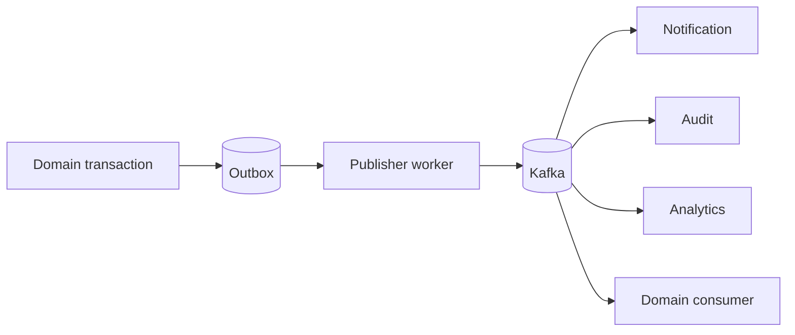

# Событийная архитектура

## Издатели

| Publisher | Topic | Источник публикации |
|---|---|---|
| Auth | `auth.events.v1` | Outbox |
| Profile | `profiles.events.v1` | Outbox |
| Department | `departments.events.v1` | Outbox |
| Brigade | `brigades.events.v1` | Outbox |
| Ticket | `tickets.events.v1` | Outbox |
| Dispatch | `dispatch.events.v1` | Outbox |
| Routing | `routing.events.v1` | Outbox |
| Location | `locations.events.v1` | Redis Stream → Kafka |
| Asset | `assets.events.v1` | Outbox |
| SLA | `sla.events.v1` | Outbox |
| Report | `reports.events.v1` | Outbox |
| File | `files.events.v1` | PostgreSQL trigger → outbox → Kafka |
| Notification | `notifications.events.v1` | PostgreSQL triggers → outbox → Kafka |

## Потребители

| Consumer | Topics |
|---|---|
| Brigade | `profiles.events.v1`, `routing.events.v1`, `tickets.events.v1` |
| Ticket | `routing.events.v1`, `reports.events.v1` |
| Dispatch | `tickets.events.v1` |
| Routing | `tickets.events.v1` |
| SLA | `tickets.events.v1` |
| Report | `tickets.events.v1` |
| Notification | tickets, sla, dispatch, departments, brigades, locations, routing, files, reports (`*.events.v1`) |
| Audit | auth, tickets, departments, brigades, profiles, locations, routing, dispatch, sla, files, notifications, reports, assets (`*.events.v1`) |
| Analytics | auth, tickets, departments, brigades, profiles, locations, routing, dispatch, sla, files, notifications, reports, assets (`*.events.v1`) |

## Реализовано и настроено

`files.events.v1` публикует **File_Service**, а `notifications.events.v1` —
**Notification_Service**. В обоих сервисах PostgreSQL-триггеры сохраняют событие
в `outbox_events` в транзакции изменения состояния. Запускаемый вместе с сервисом
передатчик отправляет зафиксированные события в Kafka.

| Топик | Типы событий |
|---|---|
| `files.events.v1` | `file.created`, `file.uploaded`, `file.linked`, `file.quarantined`, `file.deleted` |
| `notifications.events.v1` | `notification.created`, `notification.read`, `notification.delivery.sent`, `notification.delivery.failed`, `notification.delivery.dead` |

Доставка — at-least-once. При повторной отправке сохраняются `event_id` и время
события; Audit и Analytics исключают повторы. Ошибки Kafka сохраняются в outbox,
отправка повторяется с задержкой до 256 секунд без удаления события.
`source_event_id` в уведомительных событиях связывает их с исходным событием;
это отдельное поле, а не ID нового исходящего события.

Перед запуском новой версии применяются миграции
`File_Service/scheme/20261116000100_create_event_outbox.sql` и
`Notification_Service/scheme/20261116000100_create_event_outbox.sql`.
Для обоих передатчиков обязателен `KAFKA_BROKERS`; топики создаёт `kafka-init`.
События для существовавших до миграции записей задним числом не создаются.

Подписка Notification на файловые события сохраняется, но его фильтр
`isUserFacingEvent` не создаёт из них пользовательские уведомления. Audit и
Analytics читают оба топика; наличие записи в журнале Analytics не означает
наличия отдельного показателя или проекции для каждого вида события.

Поля событий, гарантии доставки и команды интеграционных проверок описаны в
[карте взаимодействий](../docs/architecture/code-interactions.md#темы-kafka).

## Общая модель

Location является исключением из стандартной outbox-схемы и использует Redis Stream как источник для передачи coordinate events в Kafka.

### Источники
[code-interactions.md](https://github.com/FIZZI-77/automatic_system/blob/test/docs/architecture/code-interactions.md)
