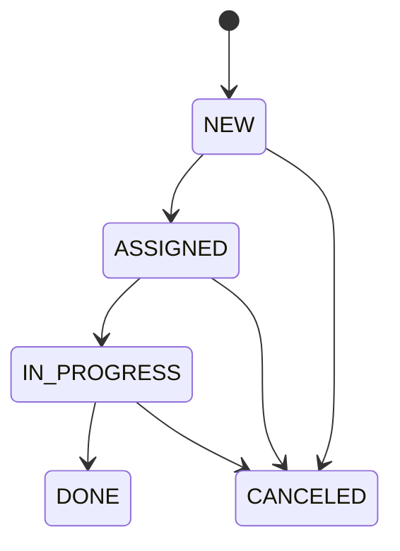
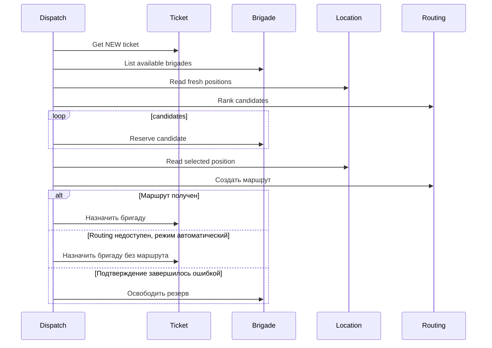
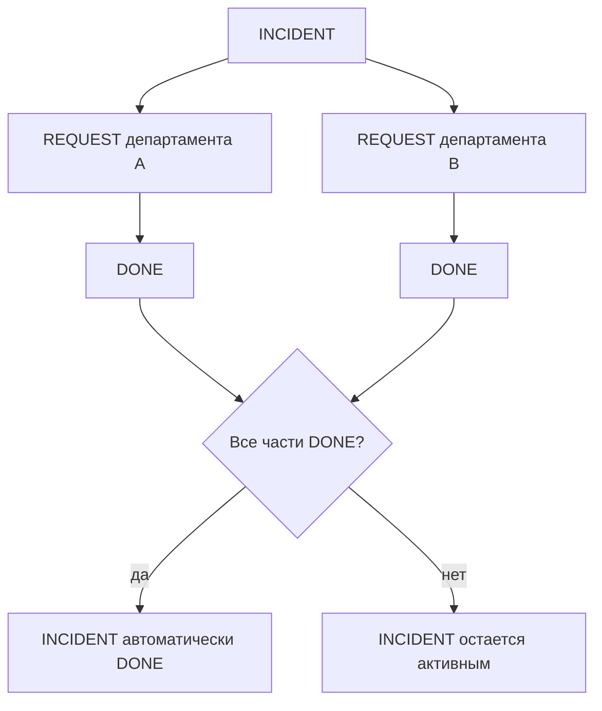
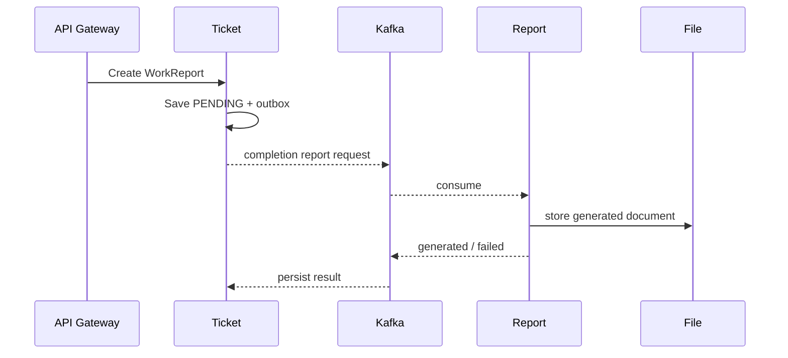

# Жизненный цикл заявки

## Состояния заявки

`DONE` и `CANCELED` — конечные состояния публичного API. Фоновая обработка
переводит старые записи в `ARCHIVED` внутри базы. По умолчанию архивация
включена, порог составляет 24 часа, а порог удаления — 30 дней.
См. [настройки хранения Ticket](https://github.com/FIZZI-77/automatic_system/blob/test/Ticket_Service/src/cmd/server/retention.go).

## Создание

1. Пользователь аутентифицируется через Auth.
2. Frontend отправляет обращение в Gateway. Партнёрская система использует
   `POST /integrations/tickets/requests` с идентификатором интеграции и секретом.
3. Ticket создаёт запись `REQUEST` и связывает её с активным `INCIDENT` той
   же категории и департамента в радиусе 100 м за последние 24 часа. Если
   совпадения нет, создаёт новый инцидент.
4. Повтор `external_id` для той же интеграции и департамента возвращает
   ранее принятое обращение. Несколько обращений могут ссылаться на один инцидент.
5. Ticket записывает исходящие события для SLA, Notification, Audit, Analytics
   и других потребителей.

## Назначение

При ошибке Dispatch компенсирует достигнутые шаги. Неосвобождённый резерв
остаётся помеченным `release_pending` и обрабатывается повторно.
См. [диспетчеризацию](Dispatch-Service).

## Выполнение

Worker может перевести назначенную своей бригаде заявку в `IN_PROGRESS`, затем в `DONE`, и добавить work report.

## Составной междепартаментный инцидент

Составной инцидент объединяет несколько обычных заявок `REQUEST`. Части могут
принадлежать разным департаментам и выполняются независимо: у каждой свой статус,
бригада, история и отчеты.

Диспетчер присоединяет и отсоединяет заявки своего департамента, администратор
может управлять всеми частями. Пока хотя бы одна учитываемая часть имеет
состояние, отличное от `DONE`, ручное завершение или отмена общего инцидента
отклоняется. Это правило применяется и к `CANCELED`. Список и подсчёт частей
исключают `ARCHIVED`. Сама архивация записывает историю и событие для части.
См. [запросы состава и условия закрытия](https://github.com/FIZZI-77/automatic_system/blob/test/Ticket_Service/src/core/repository/request_repo.go).

## Отчёт о завершении

Источник истины о work report остаётся в Ticket; Report отвечает за формирование artifact.

### Источники
- [Ticket Service README](https://github.com/FIZZI-77/automatic_system/blob/test/Ticket_Service/README.md)
- [Dispatch Service README](https://github.com/FIZZI-77/automatic_system/blob/test/Dispatch_Service/README.md)
